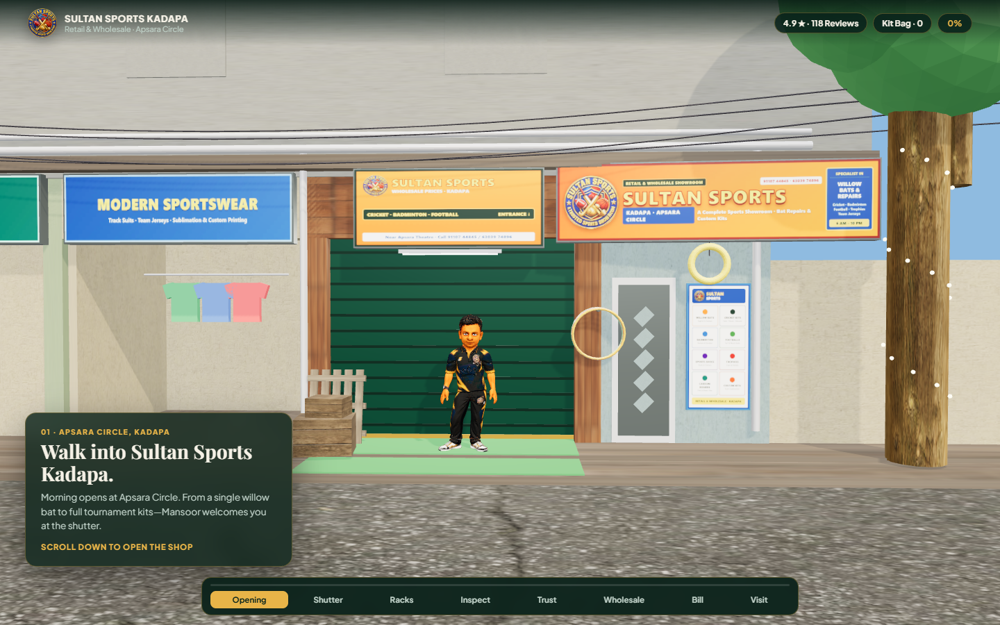
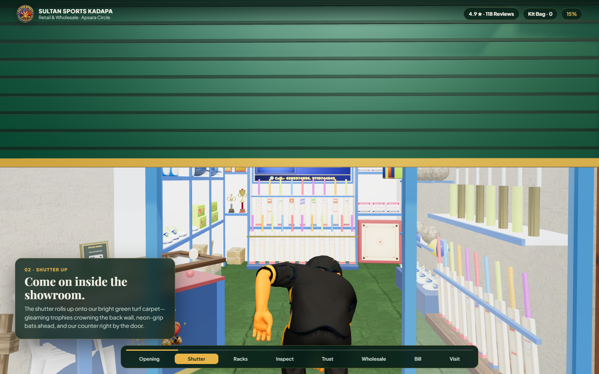
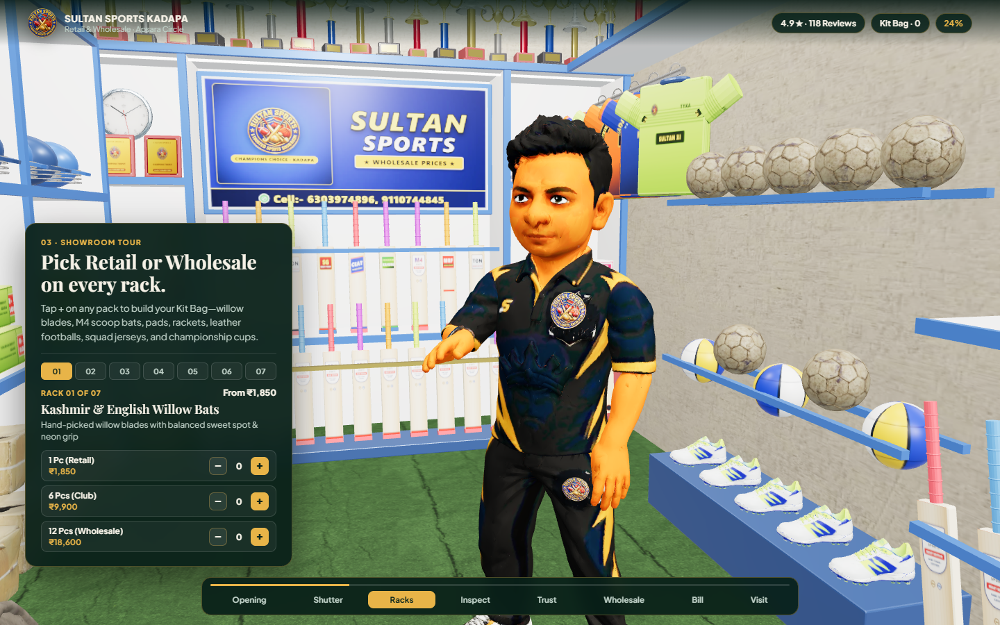
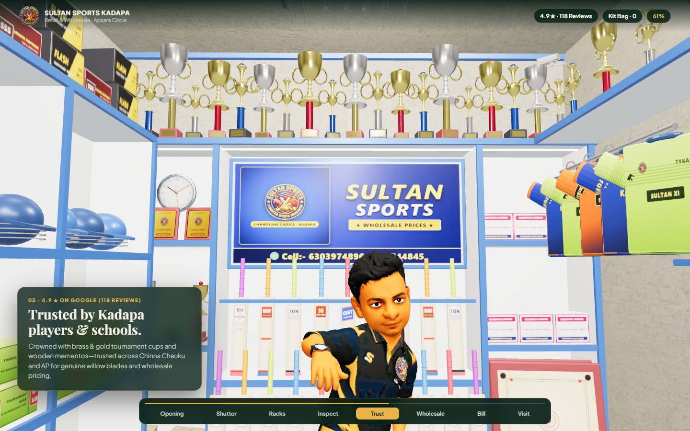
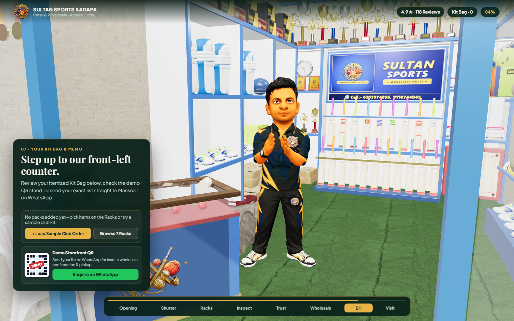
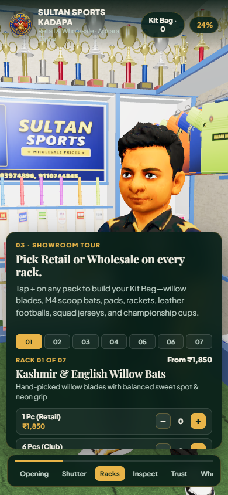
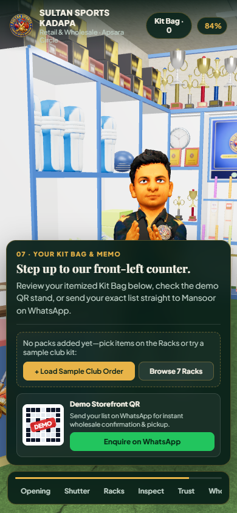

# Sultan Sports Kadapa 3D Website: Review

Project: `C:\Users\liter\Downloads\3D website`. Review written on 25 Nov 2026. Nothing in the app code was changed when this review was made.

## How it works (plain words)

Think of the site as a **film that plays as you scroll**. The shop is a 3D set. The camera is on a rail, and your scroll position decides where it stands.

| Part | File | Job |
|---|---|---|
| Story script | `src/modules/brand/storeData.js` | Shop details, 7 products with prices, and 8 chapters. Each chapter has a camera spot, a mascot spot and its text. |
| Scroll director | `scroll-engine/ScrollStoryEngine.js` | Turns scroll position (0 to 100%) into "which chapter, where is the camera, is the shutter open". Uses Lenis (smooth scroll) and GSAP. |
| 3D stage | `scene/Phase1Stage.js` | Three.js scene. Loads 4 models (shop outside, shop inside, emblem, mascot), lights, shadows, the rolling shutter and the walking mascot. |
| On-screen UI | `story-ui/StoryOverlay.js` | Story card, chapter buttons, rack tabs, **Kit Bag**, and the WhatsApp order message. |
| Cart | `cart/CartStore.js` | Remembers the Kit Bag in the browser and builds the WhatsApp order text. |

Customers add packs to the Kit Bag, then tap **Send Order on WhatsApp**. There is no payment system, which suits a local shop.

## What I measured

| Check | Result |
|---|---|
| Console errors / failed downloads | **None** |
| Speed while scrolling | 152 fps, but on **your RTX 5070 Ti**. A mid-range phone will be much slower. |
| Download size | **about 14 MB** before the site is usable (`interior.glb` 5.4 MB, `exterior.glb` 2.9 MB, mascot 2 MB) |
| Load time on your PC | 4.4 s desktop |
| Page height | about 12,600 px of scrolling to reach the end |

## Screenshots

The other chapters looked fine (they are the same style).

## What is already good

- The look is strong. The green, gold and navy brand colours are consistent, the trophy wall looks great, and the story card is easy to read.
- The shop details and prices all live in one file (`storeData.js`), so the owner can edit them easily.
- It has no errors, the code is tidy and split into clear modules, and it respects "reduce motion" settings.
- The Kit Bag to WhatsApp idea fits how Kadapa customers actually order.

## Improvements, most important first

### 1. Phones (most of your customers)
- **Top bar is cramped.** On mobile "Kit Bag · 0" wraps onto two lines and the shop subtitle overlaps the text. Hide the subtitle and the rating pill on small screens.
- **Chapter buttons are cut off** at "Who…". Make them scroll sideways with a fade at the edge, or show only the active chapter and arrows.
- **Rack card is covered.** The third pack row (12 Pcs Wholesale) sits under the bottom bar, so it is hard to reach. Add bottom spacing or let the card scroll.
- **The mascot is mostly hidden** behind the card on mobile. Move the camera or mascot up a little for narrow screens.

### 2. Loading and speed
- **The loading bar only tracks the mascot (2 MB).** The site says "ready" before the shop models (8 MB) finish, so the shop can pop in late. Use one Three.js `LoadingManager` so the bar covers all four models.
- **Shrink the 14 MB.** Compress textures (KTX2) and geometry (Draco or Meshopt), and resize the 0.46 MB logo. Try for **under 6 MB**.
- **Lower quality on weaker devices.** Cap pixel ratio at 1.5 on phones, use a smaller shadow map (1024), and drop the extra lights. Lower the quality automatically if the frame rate falls under about 40 fps.
- **Stop drawing when it is not needed.** The scene redraws constantly, even when the tab is hidden. Pause when the tab is hidden.

### 3. Scenes that look awkward
- **Chapter 2 (Shutter):** the mascot is bent over with his back to the camera, and the shutter hides half the screen. Turn him to face us, or start the camera lower.
- **Chapter 3 (Racks):** the mascot stands in front of the bat wall he is describing. Move him to the side.

### 4. Getting found on Google and WhatsApp (important for a local shop)
- All the words (address, hours, phone, prices) are created by JavaScript, so Google sees an almost empty page. Add a plain-HTML section with the shop details.
- Add a page description, a share image (the preview shown when the link is sent on WhatsApp), and "LocalBusiness" data (address, hours, phone, rating).
- Add a **"Classic view"** button: a simple scrolling product list with a **Call** and a **WhatsApp** button. It helps shoppers on slow phones and anyone who just wants prices fast.

### 5. Ordering
- **The QR code is fake.** It is a hand-drawn pattern with a "DEMO" badge. Hide it until the real UPI ID is added, then generate a real UPI QR.
- "Mansoor bhai" is written into the WhatsApp message in the code. Move it into `storeData.js` so it is easy to change.
- Add a floating **Call** button on mobile.

### 6. Accessibility and code quality
- Every Kit Bag change rebuilds the whole card, so keyboard focus is lost after pressing + or −. Update only the numbers instead.
- The story card announces every chapter change to screen readers, and there is no keyboard shortcut to skip. Add arrow-key or "next chapter" support.
- `Phase1Stage.js` repeats the same loading code four times. Merge it into one helper, and rename the file to something like `ShowroomStage`.
- Add `.env`-style settings (WhatsApp number, UPI ID) so the owner never edits code.

### 7. Project tidiness
- Folder sizes: `assets` 166 MB, `scripts/temp` 153 MB (ignored by git), `archive` 31 MB (includes a 12 MB PDF). Check that large source files are not being committed. For big model files, consider Git LFS or keeping them outside the repo.
- Four files in `scripts/` have uncommitted changes. Commit or review them.

### 8. Putting it online
The built site is only about 12 MB of static files, so AWS S3 + CloudFront (or Vercel / Netlify / Cloudflare Pages) can host it cheaply. Do the compression in section 2 first, because 14 MB hurts on mobile data.

## Suggested order of work
1. Fix mobile layout (section 1).
2. Fix the loading bar and shrink the models (section 2).
3. Add Google and WhatsApp preview info plus the Classic view (section 4).
4. Fix the two awkward scenes (section 3).
5. Remove or replace the fake QR (section 5).

## Related notes from earlier (hosting this on AWS)

- Your AWS project is on the **Free Plan** (about $119.72 credits at the time, valid until 12 May 2027). S3 + CloudFront can host this static site with those credits.
- When the credits run out or the date passes, the project pauses until you upgrade to a Paid Plan in AWS Settings.
- AWS credits **cannot** buy a custom domain. For a branded .com, buy one from a low-cost registrar. A free *.cloudfront.net link works for testing.

## Next session checklist

- [ ] Read this file
- [ ] Choose what to start with (suggested: mobile layout fixes, then loading and model size)
- [ ] Decide whether to host on AWS or Vercel / Netlify / Cloudflare Pages
